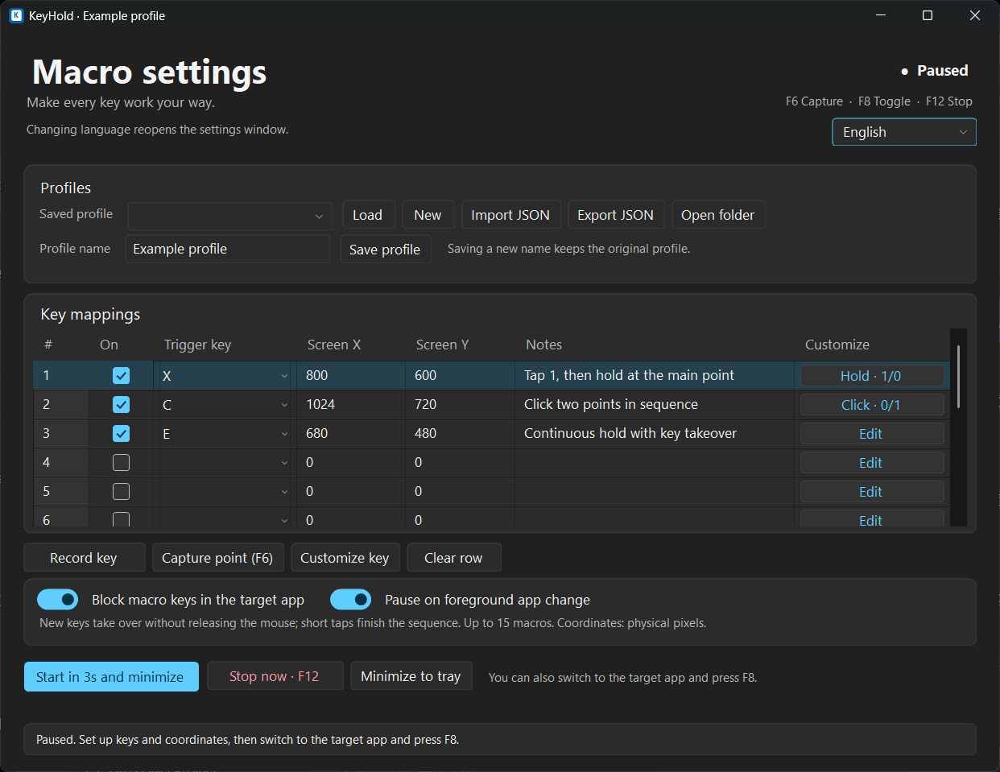
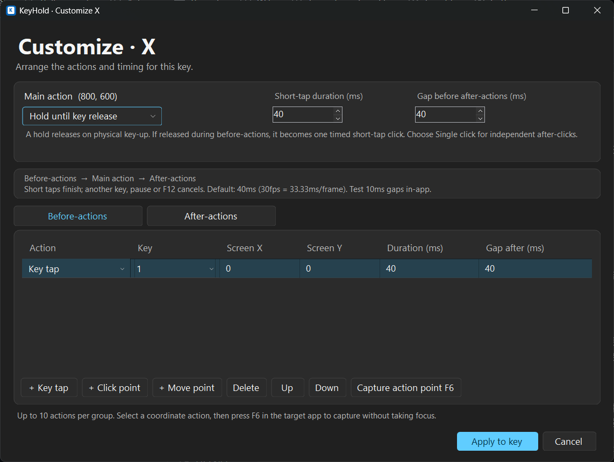

# KeyHold

[简体中文](README.md) · English

A background keyboard and mouse macro tool for **Windows 11**. Map a single key to a screen coordinate: pressing it moves the cursor and holds the left mouse button; releasing it releases the button. Add before-actions and after-actions to customize each key.

Built with C# 5, .NET Framework 4.8 and WinForms. No third-party runtime dependencies or in-game overlay. **KeyHold always starts paused.**

## Features

- Named profiles with up to 15 single-key macros and JSON import/export.
- A newer macro key takes over a continuous mouse hold by moving the cursor. Releasing the older key does not interrupt it.
- Up to 10 before-actions and 10 after-actions per key: key taps, coordinate clicks and moves, with independent durations and gaps.
- Main action modes: Hold until key release or Single click. A quick tap completes a finite personalized sequence.
- Optional key interception, automatic pause on foreground-window changes, global point capture and a system tray menu.
- Native Windows window chrome, Fluent-style controls and system light/dark themes.
- English and Simplified Chinese UI, including customization, tray menus, status messages and validation errors.





## Download and use

Download [KeyHold v0.2.0 portable ZIP](https://github.com/FrancisRi/KeyHold/releases/download/v0.2.0/KeyHold-v0.2.0-win.zip). Release notes and SHA-256 checksums are available in [Releases](https://github.com/FrancisRi/KeyHold/releases).

Requires Windows 11 and .NET Framework 4.8. Extract the complete ZIP, then run `KeyHold.exe`.

1. Enter a profile name and choose a macro key.
2. Select its row, position the cursor in the target application and press **F6** to capture the point.
3. Save the profile. Switch to the target application and press **F8** to start.
4. Hold the macro key to hold the left mouse button at its coordinate. Release the key to release the button.
5. Press **F12** for an emergency stop and release.

| Hotkey | Action |
| --- | --- |
| F6 | Pause and capture the cursor coordinates into the selected row/action |
| F8 | Start / pause |
| F12 | Emergency stop and release |

These three keys are reserved. Minimize the window to keep KeyHold in the tray; double-click the tray icon to reopen settings and pause macros.

Choose **English** or **简体中文** in the upper-right language selector. On first launch, Chinese Windows UI cultures select Simplified Chinese; other cultures select English. Your choice is saved for later launches. Changing language pauses macros, offers to save unsaved changes, then reopens settings in the chosen language, still paused. Profile names and notes are user data and are never translated. Native file-dialog controls and message-box buttons follow the Windows language.

## Behavior and timing

For two keys E and F: E down moves to E and presses the left button; F down moves to F without releasing or pressing again; E up does nothing to the mouse; F up releases the button. Releasing the current key never restores an older key that is still held. Release and press that older key again to activate it.

Customization runs **before-actions → main action → after-actions** on key-down. Main Hold mode supports key taps and move actions afterward; independent after-clicks require main Single click mode.

A physical key release lets a finite sequence finish. If a before-action delayed the main Hold, releasing the trigger early turns that Hold into one timed click. An already-active persistent Hold still releases immediately on key-up. A newer macro press, pause, F6/F12, reconfiguration or focus-loss pause cancels the previous sequence immediately. Keyboard auto-repeat does not restart sequences.

At 30 logical frames/second, one frame is about 33.33ms. New durations and gaps default to **40ms** with some margin. They remain editable: durations are 1–60000ms and gaps are 0–60000ms. Gaps start when the previous action actually finishes. A 10ms gap is allowed, but neither 10ms nor the default guarantees recognition by the target application. Macros without customization remain immediate.

Coordinates are physical desktop pixels. Capture them again after changing the display layout or the target application's position.

## Build and test

Run in native Windows PowerShell or Command Prompt:

```powershell
git clone https://github.com/FrancisRi/KeyHold.git
cd KeyHold
.\Build.cmd
.\Test.cmd
.\Start.cmd
```

The scripts use the .NET Framework C# compiler included with Windows and pause before returning. Visual Studio, Python and AutoHotkey are not required.

The default suites perform **778 checks**: 246 core/sequence, 20 worker and 512 UI checks. They use fake input and install no real keyboard hooks or simulated mouse/keyboard input. UI checks need a Windows desktop and cover both languages, themes and minimum-window command layouts. Language preference tests use temporary files. Existing version 1/2 JSON profiles remain compatible.

Optional desktop checks are separate from `Test.cmd`: `ScrollInteractionTests.cs` moves the real cursor only inside its own preview; `StartupPaintTests.cs` displays preview windows and captures startup frames. Both use previews without macro listeners.

Profiles remain in `%LOCALAPPDATA%\KeyHoldMacro\Profiles` for compatibility. The language choice is stored separately in `%LOCALAPPDATA%\KeyHoldMacro\language.txt`. The `KeyHoldMacro` source namespace and single-instance mutex are also preserved.

## Limitations and verification

Windows may reject simulated input when privilege levels differ. Some target applications ignore simulated input or use input paths that keyboard hooks cannot fully intercept. Exclusive-fullscreen compatibility and recognition of real input must be tested in the specific target application. No driver or process injection is used.

Automated checks do not establish universal compatibility. Real keyboard interception, mouse hold/release and F12 behavior in the target app, tray interactions, lock/sleep transitions, multiple monitors, negative coordinates, and DPI scaling still need manual verification. Start with an ordinary window before using an exclusive-fullscreen application.

See the [Chinese usage guide](使用说明.md) for the detailed verification history. Report problems through [GitHub Issues](https://github.com/FrancisRi/KeyHold/issues), including Windows version, display scaling and reproduction steps.

## License

[MIT License](LICENSE), copyright © 2026 FrancisRi.
