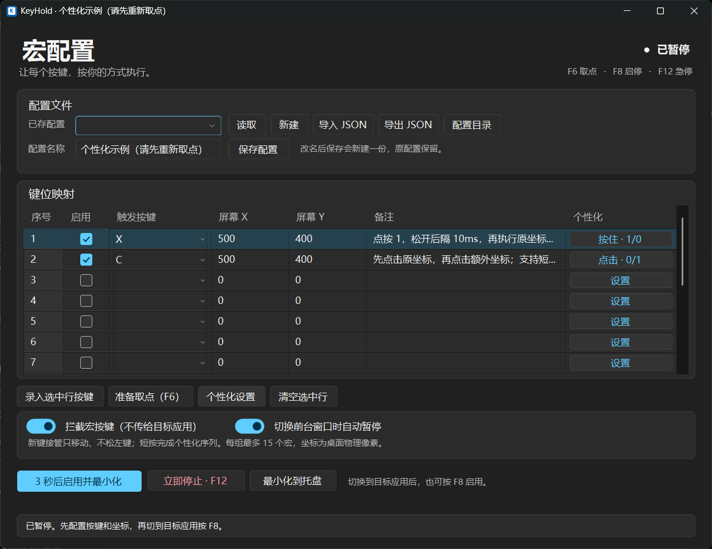
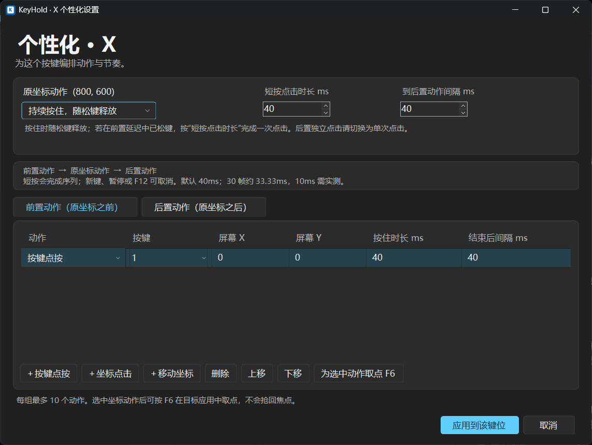

# KeyHold

简体中文 · [English](README.en.md)

适用于 **Windows 11** 的后台按键与鼠标宏工具。将一个按键映射到屏幕坐标，按住时保持鼠标左键；也可以为每个键编排前置、后置动作及时间间隔。

使用 C#、.NET Framework 4.8 和 WinForms 开发，无第三方运行库依赖。程序启动时始终暂停，不显示游戏内覆盖层。

## 功能

- 命名配置，每组最多 15 个单键宏；支持保存、切换与 JSON 导入/导出。
- 新键接管时保持左键连续按住，只移动到新位置；旧键松开不会打断新键。
- 每个键最多 10 个前置动作和 10 个后置动作，支持按键点按、坐标点击及移动。
- 原坐标支持持续按住或单次点击；短按也会完成已触发的有限动作序列。
- 动作时长与间隔独立设置，默认 40ms，可按目标应用调整。
- 可选按键拦截、切换前台窗口自动暂停、全局取点和系统托盘。
- Windows 原生窗口与 Fluent 风格界面，跟随系统深浅主题。
- 简体中文 / English 界面，首次按系统语言选择，并记住手动选择。





浅色预览：[主界面](docs/screenshots/main-light.png) · [个性化设置](docs/screenshots/editor-light.png)。

## 获取与运行

下载 [KeyHold v0.2.1 便携版 ZIP](https://github.com/FrancisRi/KeyHold/releases/download/v0.2.1/KeyHold-v0.2.1-win.zip)，或在 [Releases](https://github.com/FrancisRi/KeyHold/releases) 查看版本说明及 SHA-256 校验文件。也可以下载源码后自行编译。

系统要求：Windows 11、.NET Framework 4.8。无需安装 Python、AutoHotkey 或 Visual Studio。

1. 将发行包解压到普通文件夹。
2. 双击 `KeyHold.exe`，程序以暂停状态打开。
3. 填写配置名称、选择按键，并使用 F6 取点。
4. 保存配置，切到目标应用后按 F8 启用。
5. 按住宏键执行；按 F12 可随时紧急停止并释放程序按下的输入。

右上角可选择简体中文或 English。切换时先暂停，提示保存未保存的配置，再重新打开配置窗口；新窗口仍为暂停状态。已有配置名称、备注和 JSON 动作标识保持原样。系统原生文件对话框和消息框按钮的语言由 Windows 决定。

| 快捷键 | 功能 |
| --- | --- |
| F6 | 暂停并将当前鼠标坐标填入选中项 |
| F8 | 启用 / 暂停 |
| F12 | 紧急停止与释放 |

这三个快捷键为程序保留。完整操作说明及行为边界见 [使用说明](使用说明.md)。

## 连续接管示例

E、F 分别映射到两个坐标：

1. 按住 E：移到 E 的坐标并按下左键。
2. 保持 E，再按 F：左键持续按住，移到 F 的坐标。
3. 松开 E：保持 F 当前的按住状态。
4. 松开 F：释放左键，不恢复仍按住的旧宏。

## 从源码构建

下载源码 ZIP 并解压，或使用 Git：

```powershell
git clone https://github.com/FrancisRi/KeyHold.git
cd KeyHold
.\Build.cmd
.\Start.cmd
```

`Build.cmd` 使用 Windows 自带的 .NET Framework C# 编译器生成 `KeyHold.exe`；脚本结束前会等待按键。`Start.cmd` 在 EXE 不存在时先编译，再启动程序。

## 测试

```powershell
.\Test.cmd
```

默认测试不安装真实键盘钩子、不发送真实鼠标或键盘输入。三组测试应均显示 `PASS`：

- 核心及动作序列：246 项检查，含语言选择、偏好保存及跨语言 JSON 兼容。
- 后台工作线程：20 项检查，使用假的 Windows 接口，含英文状态提示。
- WinForms 界面：536 项检查，覆盖中英文及最小窗口下的按钮布局，需要 Windows 桌面环境。

`tests/ScrollInteractionTests.cs` 和 `tests/StartupPaintTests.cs` 是可选桌面验证，不包含在默认测试中。前者会移动真实鼠标并仅拖动无宏监听预览里的滚动条；后者显示预览并捕获启动、按键选择后全屏窗口遮挡/最小化恢复及连续悬停帧（无边框窗口模拟遮挡，不模拟独占显示模式切换）。运行可选验证时应保持测试窗口不受遮挡。

## 项目结构

```text
src/             配置、动作引擎、Windows 输入接口及界面
tests/           核心、工作线程和界面验证
examples/        示例 JSON 配置，使用前须重新取点
assets/          应用图标
tools/           图标生成工具
docs/screenshots/ 界面预览
```

配置保存在 `%LOCALAPPDATA%\KeyHoldMacro\Profiles`，保留旧目录名以兼容已有配置。源码命名空间 `KeyHoldMacro` 同样保留。

## 兼容性与边界

- 输入通过 Windows 钩子与 `SendInput` 实现。目标应用可能忽略模拟输入或使用原始输入路径，独占全屏兼容性需要在目标程序内实测。
- 目标应用以管理员身份运行时，KeyHold 需要匹配权限级别。
- 坐标使用物理桌面像素，支持负坐标；改变屏幕布局、分辨率或目标应用布局后应重新取点。
- 30 逻辑帧/秒的一帧约为 33.33ms，默认 40ms 是带余量的起点，不能保证所有目标程序识别。
- 已在本机 Windows 11 验证编译、自动化测试及部分桌面显示和交互。其他缩放、多屏、输入法候选窗口和目标应用的实际输入仍需实机验证。

反馈问题时请提供 Windows 版本、缩放比例、复现步骤，以及去除个人信息的最小配置示例：[提交 Issue](https://github.com/FrancisRi/KeyHold/issues)。

## 许可证

[MIT License](LICENSE)，Copyright (c) 2026 FrancisRi。
