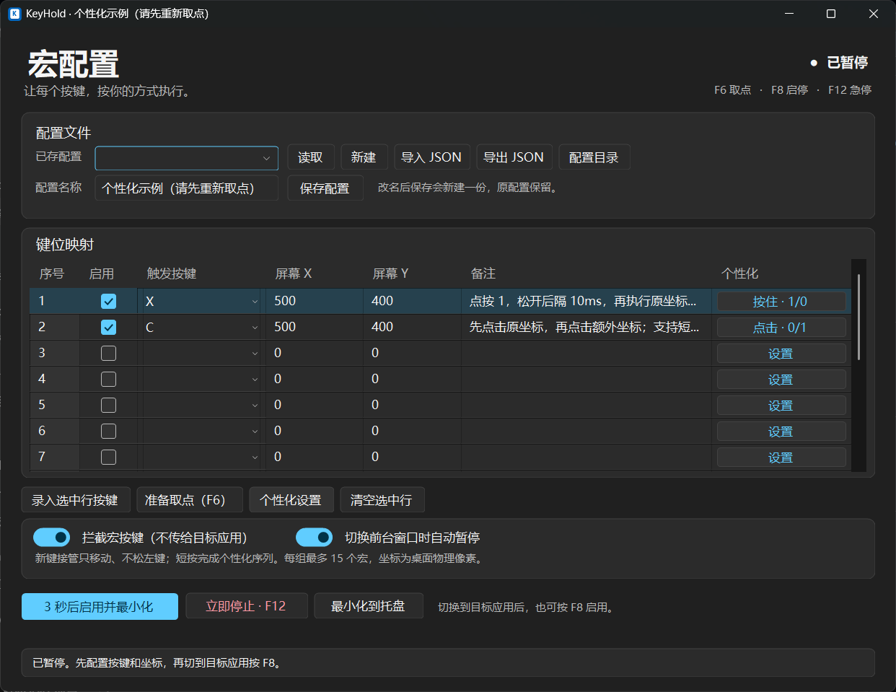
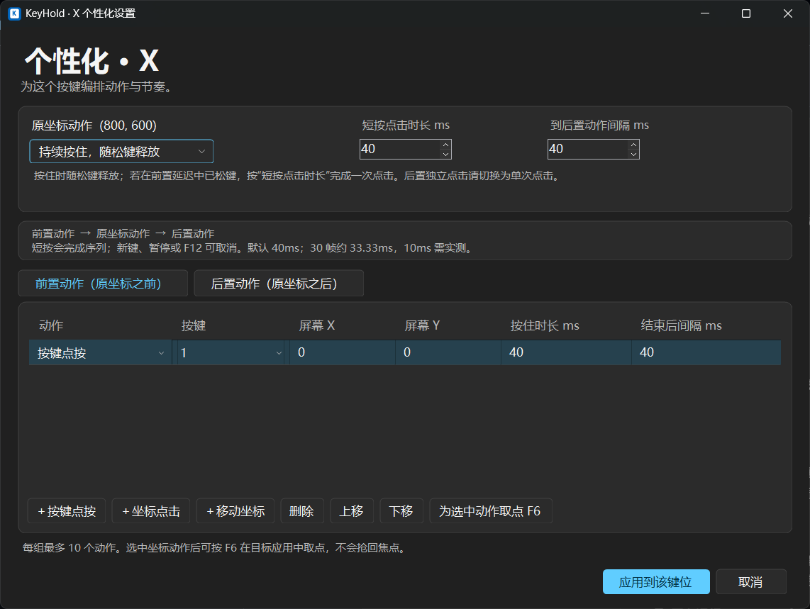

# KeyHold

简体中文 · [English](README.en.md)

适用于 **Windows 11** 的后台按键与鼠标宏工具。将一个按键映射到屏幕坐标，按住时保持鼠标左键；也可以为每个键编排前置、后置动作及时间间隔。

KeyHold 使用 C# WinForms（.NET Framework 4.8）界面和 Rust 后台。宏状态机、键盘钩子、动作调度及模拟输入由 Rust 执行。程序启动时始终暂停，不显示游戏内覆盖层。

## 功能

- 命名配置，每组最多 15 个单键宏；支持保存、切换与 JSON 导入/导出。
- 新键接管时保持左键连续按住，只移动到新位置；旧键松开不会打断新键。
- 每个键最多 10 个前置动作和 10 个后置动作，支持按键点按、坐标点击及移动。
- 原坐标支持持续按住或单次点击；短按也会完成已触发的有限动作序列。
- 动作时长与间隔独立设置，均默认 40 ms，可按目标应用调整。
- 可选按键拦截、切换前台窗口自动暂停、全局取点和系统托盘。
- Windows 原生窗口与 Fluent 风格界面，跟随系统深浅主题。
- 简体中文 / English 界面，首次按系统语言选择，并记住手动选择。
- 全屏状态提示音：区分启用、暂停、紧急停止和错误，支持关闭、记住设置及安全试听。





浅色预览：[主界面](docs/screenshots/main-light.png) · [个性化设置](docs/screenshots/editor-light.png)。

## 获取与运行

下载 [KeyHold v0.4.0 Windows x64 便携版 ZIP](https://github.com/FrancisRi/KeyHold/releases/download/v0.4.0/KeyHold-v0.4.0-win-x64.zip)，或在 [Releases](https://github.com/FrancisRi/KeyHold/releases) 查看版本说明及 SHA-256 校验文件。也可以下载源码后自行编译。

系统要求：Windows 11 x64、.NET Framework 4.8。便携版包含 Rust 后台，解压后请将 `KeyHold.exe`、`KeyHold.exe.config` 和 `keyhold_worker.dll` 放在同一目录。

1. 将发行包解压到普通文件夹。
2. 双击 `KeyHold.exe`，程序以暂停状态打开。
3. 填写配置名称、选择按键，并使用 F6 取点。
4. 保存配置，切到目标应用后按 F8 启用。
5. 按住宏键执行；按 F12 可随时紧急停止并释放程序按下的输入。

右上角可选择简体中文或 English。切换时先暂停，提示保存未保存的配置，再重新打开配置窗口；新窗口仍为暂停状态。已有配置名称、备注和 JSON 动作标识保持原样。系统原生文件对话框和消息框按钮的语言由 Windows 决定。

| 快捷键 | 功能 |
| --- | --- |
| F6 | 暂停并将当前鼠标坐标填入选中项 |
| F8 | 启用 / 暂停 |
| F12 | 紧急停止与释放 |

这三个快捷键为程序保留。完整操作说明及行为边界见 [使用说明](使用说明.md)。

状态提示音默认开启：成功启用播放上行双音，暂停播放下行双音，F12/紧急停止和错误各有不同的三短音。只有实际启用成功才会播放启用音；普通取点或打开设置时，如果本来已暂停则保持安静。可通过“状态提示音”开关关闭，选择跨配置和重启保留。点击“试听提示音”依次试听四种声音，试听不会启用宏，关闭自动提示音后仍可主动试听。音量跟随 Windows 中 KeyHold 的应用音量。

## 连续接管示例

E、F 分别映射到两个坐标：

1. 按住 E：移到 E 的坐标并按下左键。
2. 保持 E，再按 F：左键持续按住，移到 F 的坐标。
3. 松开 E：保持 F 当前的按住状态。
4. 松开 F：释放左键，不恢复仍按住的旧宏。

## 从源码构建

在原生 Windows PowerShell 中安装 [rustup](https://rustup.rs/) 的 x64 GNU 工具链，然后构建：

```powershell
git clone https://github.com/FrancisRi/KeyHold.git
cd KeyHold
rustup toolchain install stable-x86_64-pc-windows-gnu --profile minimal
.\Build.cmd
.\Start.cmd
```

`Build.cmd` 构建 Rust DLL 和 x64 WinForms EXE；工具链安装后可离线构建。`Start.cmd` 在缺少 EXE 或 DLL 时先构建。两者所用的构建入口为 `tools/Build.ps1`，可直接调用以跳过脚本的等待按键步骤。

## 测试

```powershell
.\Test.cmd
```

默认测试不安装真实键盘钩子、不发送真实鼠标或键盘输入，也不播放真实声音：

- Rust 引擎、后台逻辑和原生接口：24 项测试，使用假输入及虚拟时钟验证关键行为。
- C# 参考引擎及配置、提示音：292 项检查；C# 参考后台：32 项假 Win32 检查。参考引擎和后台只参与测试。
- WinForms 和桥接：587 项检查，覆盖界面、命令快照、状态回执及真实 DLL 加载；需要 Windows 桌面环境。

`tests/ScrollInteractionTests.cs` 和 `tests/StartupPaintTests.cs` 是可选桌面验证，不包含在默认测试中。前者会移动真实鼠标并仅拖动无宏监听预览里的滚动条；后者显示预览并捕获启动、按键选择后全屏窗口遮挡/最小化恢复及连续悬停帧（无边框窗口模拟遮挡，不模拟独占显示模式切换）。运行可选验证时应保持测试窗口不受遮挡。

## 项目结构

```text
src/             WinForms 界面、配置存储、提示音和 DLL 桥接
rust/            Rust 宏引擎、Windows 输入后台及其测试
tests/           C# 参考引擎、配置及界面验证
examples/        示例 JSON 配置，使用前须重新取点
assets/          应用图标
tools/           构建测试入口及图标生成工具
docs/screenshots/ 界面预览
```

配置保存在 `%LOCALAPPDATA%\KeyHoldMacro\Profiles`，保留旧目录名以兼容已有配置。源码命名空间 `KeyHoldMacro` 同样保留。

## 兼容性与边界

- 输入通过 Windows 钩子与 `SendInput` 实现。目标应用可能忽略模拟输入或使用原始输入路径，独占全屏兼容性需要在目标程序内实测。
- 目标应用以管理员身份运行时，KeyHold 需要匹配权限级别。
- 坐标使用物理桌面像素，支持负坐标；改变屏幕布局、分辨率或目标应用布局后应重新取点。
- 30 逻辑帧/秒的一帧约为 33.33 ms，动作时长和间隔是否适用需在目标程序内验证。
- 已在本机 Windows 11 验证编译、自动化测试及部分桌面显示和交互。其他缩放、多屏、输入法候选窗口和目标应用的实际输入仍需实机验证。

反馈问题时请提供 Windows 版本、缩放比例、复现步骤，以及去除个人信息的最小配置示例：[提交 Issue](https://github.com/FrancisRi/KeyHold/issues)。

## 许可证

[MIT License](LICENSE)，Copyright (c) 2026 FrancisRi。
